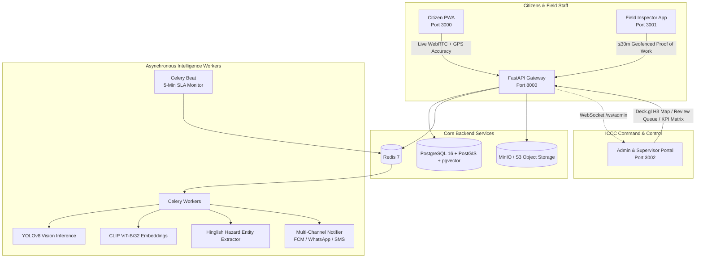

# 🏛️ CivicPulse AI (ICCC Smart Grievance & Field Accountability Engine)

> **Next-Generation Civic Issue Lifecycle, Geospatial Ward Routing & Anti-Fraud Proof-of-Work Platform**  
> *Engineered around the benchmark municipal governance model of **Indore Municipal Corporation (IMC) — 22 Zones, 85 Wards, Smart City Integrated Command and Control Centre (ICCC)**.*

[-black?style=flat-square&logo=next.js)](https://nextjs.org/)
[](https://fastapi.tiangolo.com/)
[](https://postgis.net/)
[-FF6F00?style=flat-square)](https://ultralytics.com)
[](https://redis.io/)
[](https://www.typescriptlang.org/)
[](https://python.org/)
[](LICENSE)

---

## 📌 Executive Summary & Problem Statement

Municipal corporations face thousands of civic complaints every single day (potholes, garbage dumps, overflowing sewage, open manholes, non-functional streetlights). Conventional civic portals (such as legacy 311 systems) universally break down under three chronic operational bottlenecks:

1. **Manual Triage & Duplicate Flooding:** A single overflowing garbage bin or arterial pothole triggers dozens of overlapping tickets, overwhelming call centers and polluting ward metrics.
2. **Blind Departmental Routing:** Citizens frequently miscategorize issues, routing civil engineering defects to sanitation staff and introducing 24–48 hours of routing ping-pong.
3. **Unverified "Fake Closures" & Opaque Accountability:** Field workers close complaints remotely or upload irrelevant pictures without visiting the physical site. Municipal Commissioners lack real-time visibility into which specific inspector, ward, or zone is driving SLA bottlenecks.

**CivicPulse AI** solves this end-to-end through a high-performance **Full-Stack Monorepo**: combining **WebRTC anti-spoof camera capture**, **PostGIS spatial deduplication**, **Computer Vision (YOLOv8) + Hinglish NLP hazard scoring**, **automated Ward/Zone polygon routing**, **30-meter geofenced AI proof-of-work resolution**, and a **6-tier IMC authority accountability matrix**.

---

## ⚡ 10 Core Superpowers

| # | Superpower | Mechanism | Impact / Advantage |
|:---:|:---|:---|:---|
| 1 | **30m Proof-of-Work Lock** | Resolution camera strictly requires physical proximity ($\le 30\text{ m}$) via PostGIS `ST_DistanceSphere`, device integrity check, and single-use 60s cryptographic nonce. | Eliminates remote "fake closures" without visiting the site. |
| 2 | **Spatial Deduplication** | PostGIS `ST_DWithin` ($\le 25\text{ m}$) + CLIP (`ViT-B/32`) cosine similarity merges incoming reports into an active Master Ticket, incrementing public "Me Too" counts. | 1 Physical Defect = 1 Master Ticket. No duplicate flooding. |
| 3 | **Multi-Modal AI Triage** | Ultralytics YOLOv8 classifies civic defect class & bounding-box area ratio; Hinglish NLP extracts emergency entities (`hospital`, `school`, `accident`, `live_wire`). | Priority reflects real public danger, not subjective user complaints. |
| 4 | **Dynamic Severity & SLA** | Composite scoring formula ($S \in [0, 100]$) with hard safety overrides automatically assigns dynamic countdown deadlines ($4\text{h}$ to $72\text{h}$). | Critical hazards (e.g. open manholes) never wait 48–72 hours. |
| 5 | **Ward Polygon Routing** | PostGIS `ST_Covers(ward.boundary, point)` stamps exact Ward (1–85) & Zone (1–22), balancing tickets to the least-loaded on-duty inspector. | Instant, zero-human-touch routing to the correct beat staff. |
| 6 | **Self-Enforcing Escalation** | 5-minute Celery Beat daemon checks SLA elapsed ratios: **75%** warning $\to$ **100% L1** (-5 KPI, escalates to CSI/AE) $\to$ **150% L2** (Zonal Officer + ICCC Red List) $\to$ **200% L3** (Draft Show-Cause). | Automatic administrative hierarchy climbing without manual chasing. |
| 7 | **Dual-Stage AI Verification** | Resolution photo verified via CLIP structural background similarity ($\ge 0.75$) and YOLO defect absence check; anomalies routed to Supervisor Review Queue. | Algorithmic validation prevents uploading fake/clean-wall photos. |
| 8 | **Chronic Blackspot Detection** | Automated spatial clustering flags $\ge 5$ issues within a $50\text{ m}$ radius in 30 days as deep infrastructure failures (e.g. leaking sewer pipeline causing potholes). | Transitions municipal governance from repeated patching to root-cause fixes. |
| 9 | **Staff Accountability Matrix** | Zone $\to$ Ward $\to$ Inspector drill-down calculating composite KPI: $\text{clamp}(0.4 \cdot \text{SLA}\% + 0.3 \cdot \text{CSAT} + 0.3 \cdot \text{Speed} - \text{Reopen}\%, 0, 100)$. | Super Admin (Commissioner) gets transparent, evidence-based performance data. |
| 10 | **Immutable Audit Trail** | Every state transition logs an immutable `issue_events` record with actor ID, timestamps, cryptographic nonces, and before/after states. | Absolute transparency for administrative disputes and RTI inquiries. |

---

## 🏗️ System Architecture



---

## 👥 6-Tier Role-Based Access Control (RBAC) Matrix

Modeled directly after the administrative hierarchy of **Indore Nagar Nigam (IMC)**:

| Tier & Role Code | IMC Authority Persona | Geographic Scope | Departmental Scope | System Capabilities |
|:---|:---|:---|:---|:---|
| **Tier 0:** `CITIZEN` | Citizen / Ward Mitra | City-wide (Public) | All | Anti-spoof live reporting, GPS accuracy gate ($\le 20\text{m}$), "Me Too" upvoting, live SLA tracking, CSAT rating, 48h re-open. |
| **Tier 1:** `FIELD_INSPECTOR` | **Daroga** (Sanitation), **Sub-Engineer/JE** (Civil), **Lineman** (Electrical) | **1 Assigned Ward** | Assigned Dept | Task queue, turn-by-turn navigation, on-duty toggle, 30m geofenced "After" photo submission. Masked citizen PII. |
| **Tier 2:** `WARD_SUPERVISOR` | **Chief Sanitary Inspector (CSI)** / **Assistant Engineer (AE)** | **1 to 3 Wards** | Assigned Dept | Monitor field inspectors, reassign overloaded tasks, review flagged AI closures, handle **Level-1 SLA Breaches**. |
| **Tier 3:** `ZONAL_OFFICER` | **Zonal Officer (ZO)** / **Zonal Health Officer (ZHO)** | **1 Zone (4–5 Wards)** | Cross-Dept | Inter-departmental coordination (Civil + Water), approve heavy equipment (JCB/Jetting), handle **Level-2 SLA Breaches**. |
| **Tier 4:** `DEPT_HOD` | **Additional Commissioner / Department Head** | **All 22 Zones (City)** | Single Vertical | Department-wide MTTR, chronic blackspot remediation planning, review draft **Show-Cause Notices** for defaulting staff. |
| **Tier 5:** `SUPER_ADMIN` | **Municipal Commissioner / Mayor / ICCC Admin** | **Entire City (85 Wards)** | **All Departments** | Full executive override, Deck.gl H3 density heatmaps, Inspector Leaderboards, ICCC Red List, SLA policy customization. |

---

## 📐 Algorithmic & Mathematical Specifications

### 1. Dynamic Severity Score ($S \in [0, 100]$)
$$S = 0.35 \cdot C_{\text{vision\_scale}} + 0.25 \cdot U_{\text{nlp}} + 0.25 \cdot P_{\text{spatial\_POI}} + 0.15 \cdot \min(N_{\text{upvotes}} \times 10, 100)$$

* **$C_{\text{vision\_scale}}$:** Visual hazard score $= 100 \times \text{Confidence} \times (0.6 \cdot w_{\text{class}} + 0.4 \cdot \min(\frac{\text{bbox\_ratio}}{0.25}, 1.0))$
* **$U_{\text{nlp}}$:** Extracted urgency score from Hinglish description.
* **$P_{\text{spatial\_POI}}$:** Proximity multiplier ($100$ if $\le 100\text{ m}$ to Hospital/School/Arterial highway; $50$ for commercial squares; $20$ for residential lanes).
* **Hard Safety Override:** Any detection of `OPEN_MANHOLE`, live sparking wires, or major road blockage automatically escalates priority to **CRITICAL (4–6h SLA)**.

### 2. SLA Escalation Thresholds
* **Elapsed Ratio ($R$):** $R = \frac{T_{\text{now}} - T_{\text{created}}}{T_{\text{sla}} - T_{\text{created}}}$
  * $R \ge 0.75$: Amber Warning Notification sent to Field Inspector.
  * $R \ge 1.00$ (**Level-1 Breach**): Escalates to Ward Supervisor (CSI/AE), deducts $-5$ KPI points from inspector.
  * $R \ge 1.50$ (**Level-2 Breach**): Escalates to Zonal Officer, issue flagged on the **Super Admin ICCC Red List**.
  * $R \ge 2.00$ (**Level-3 Breach**): Generates automated recommendation for a **Show-Cause Notice** for Department HOD review.

### 3. Geofenced Proof-of-Work Lock
$$\text{ST\_DistanceSphere}(\text{IssueLocation}, \text{InspectorLocation}) \le 30 \text{ metres}$$
* Camera resolution trigger is disabled client-side and verified server-side.
* Perceptual hash (`pHash`) checks prevent reusing past resolution photographs across tickets.

---

## 📂 Repository Directory Structure

```text
civicpulse-monorepo/
├── apps/
│   ├── web-citizen/          # Next.js 14 Citizen PWA (Port 3000)
│   ├── app-inspector/        # Next.js 14 Field Inspector Ops Portal (Port 3001)
│   └── web-admin/            # Next.js 14 ICCC Command Center & Supervisor Console (Port 3002)
├── backend/
│   ├── civicpulse_app/       # FastAPI Core Application Package
│   │   ├── ai/               # YOLOv8 Vision & Hinglish NLP Providers
│   │   ├── api/v1/           # REST & WebSocket Routers (Auth, Issues, Inspector, Analytics)
│   │   ├── core/             # Security, Logging, Config & Middlewares
│   │   ├── domain/           # Business Logic (Dedup, Triage, Routing, Verification, Escalations)
│   │   ├── models/           # SQLAlchemy 2 + GeoAlchemy2 + pgvector ORM Models
│   │   ├── schemas/          # Pydantic v2 Validation Schemas
│   │   ├── services/         # State Machines, Nonce & Notification Engines
│   │   └── workers/          # Celery Tasks & Celery Beat SLA Daemon
│   ├── migrations/           # Alembic Database Migration Scripts (Phases 1-7)
│   ├── tests/                # Pytest Async Test Suite
│   ├── pyproject.toml        # Python 3.12 Dependencies & Tools
│   └── yolov8n.pt            # Pinned Vision Model Weights
├── packages/
│   ├── api-client/           # Shared TypeScript SDK & OpenAPI Contract Layer
│   ├── config/               # Shared Tailwind, PostCSS & TypeScript Configs
│   └── ui/                   # Shared React Civic Design System (Light Theme Tokens, Camera, Modals)
├── infra/
│   └── postgres/             # PostGIS & pgvector Extension Initialization SQL
├── e2e/                      # Playwright End-to-End Tests & Browser Automation
├── docker-compose.yml        # PostgreSQL (pgvector/pg16) + Redis 7 + MinIO Object Store
├── package.json              # Monorepo Root npm Workspaces Configuration
└── start_services.bat        # Windows 1-Click Startup Script for All 4 Services
```

---

## 🚀 Quick Start Guide

### Prerequisites
* **Node.js**: `v20.x` or higher and `npm v10+`
* **Python**: `3.12` or higher
* **Docker & Docker Desktop**: For PostgreSQL (PostGIS), Redis, and MinIO
* **Git**

---

### Step 1: Clone the Repository
```bash
git clone https://github.com/<your-username>/civicpulse-ai.git
cd civicpulse-ai
```

---

### Step 2: Launch Supporting Infrastructure
Spin up the PostGIS database, Redis queue, and MinIO storage:
```bash
docker compose up -d
```
*Verify containers are healthy:*
* **PostgreSQL (PostGIS + pgvector):** `localhost:5432`
* **Redis:** `localhost:6379`
* **MinIO Console:** `http://localhost:9001` (User: `minioadmin`, Pass: `minioadmin`)

---

### Step 3: Backend Setup (FastAPI)
```bash
# Navigate to backend directory
cd backend

# Create virtual environment and activate
python -m venv venv
# On Windows:
.\venv\Scripts\activate
# On Linux/macOS:
source venv/bin/activate

# Install dependencies
pip install -e .

# Run database migrations
alembic upgrade head

# Start FastAPI dev server
python -m uvicorn civicpulse_app.main:app --port 8000 --reload
```
*Interactive Swagger API documentation will be available at:* **`http://localhost:8000/docs`**

---

### Step 4: Frontend Monorepo Setup (All Apps)
Open a new terminal at the root directory (`civicpulse-monorepo/`):
```bash
# Install all workspace dependencies
npm install

# Run all apps in development mode:
# Option A: Run everything with the 1-click batch script (Windows)
.\start_services.bat

# Option B: Run individual frontend apps via npm scripts
npm run dev:citizen     # Citizen PWA on http://localhost:3000
npm run dev:inspector   # Inspector App on http://localhost:3001
npm run dev:admin       # Command Center on http://localhost:3002
```

---

## 🌐 Application Port & Service Directory

| Service / Application | URL | Persona / Description |
|:---|:---|:---|
| **Citizen Portal (PWA)** | [http://localhost:3000](http://localhost:3000) | Live WebRTC capture, GPS accuracy ring, track complaints, upvote nearby issues, CSAT. |
| **Field Inspector App** | [http://localhost:3001](http://localhost:3001) | Duty toggle, assigned tasks, navigation, geofenced proof-of-work resolution. |
| **Command Center (Admin)** | [http://localhost:3002](http://localhost:3002) | 85-Ward Kanban, Deck.gl H3 Heatmap, AI Review Queue, Staff Accountability Matrix. |
| **FastAPI REST Gateway** | [http://localhost:8000](http://localhost:8000) | OpenAPI core backend endpoints and WebSocket feeds. |
| **Interactive API Docs** | [http://localhost:8000/docs](http://localhost:8000/docs) | Swagger UI for testing API endpoints. |
| **MinIO Storage Console** | [http://localhost:9001](http://localhost:9001) | Object storage for civic evidence media (User: `minioadmin` / `minioadmin`). |

---

## 🧪 Testing & Verification Suite

### Backend Unit & Integration Tests (Pytest)
```bash
cd backend
pytest -v
```
*Includes point-in-polygon routing tests, spatial deduplication verification, time-travel SLA escalation tests, and proof-of-work lock assertion.*

### End-to-End Browser Automation (Playwright)
```bash
cd e2e
npx playwright test
```

### Static Type Checking & Code Quality
```bash
# Frontend type check & lint
npm run type-check
npm run lint

# Backend formatting & linting
cd backend
ruff check .
mypy civicpulse_app
```

---

## 🔒 Security, Integrity & Privacy Guarantees

1. **Anti-Spoofing Camera Enforcement:** Direct gallery `<input type="file">` uploads are strictly disabled in citizen reporting and inspector resolution workflows. Photos must be taken via `navigator.mediaDevices.getUserMedia`.
2. **Cryptographic Capture Nonce:** Every capture request requires a single-use server nonce with a 60-second TTL to defeat replay and tampering attacks.
3. **Hardware Geofence Gate:** Resolution of tickets is physically locked if device GPS distance exceeds $30\text{ meters}$ from the original complaint coordinate.
4. **Digital Personal Data Protection (DPDP) Compliance:** Citizen mobile numbers are strictly masked for Tier-1 field staff (`+91 98765 *****`) and audited across supervisory tiers.
5. **Human-in-the-Loop Governance:** AI models assist with triage and validation; punitive administrative actions (such as Show-Cause Notices or salary deductions) require explicit officer justification and authorization.

---

## 📜 License

This project is licensed under the **MIT License** — see the [LICENSE](LICENSE) file for details.

---

*Engineered with pride for progressive, transparent, and data-driven smart municipal governance.*
