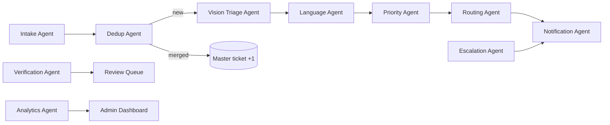

# CivicPulse AI — Runtime Agents (AI Pipeline)

Not the coding agent (see `agent.md`). These are the automated agents that run inside the product. Each is a Celery task or service with a single job, typed input/output, and an audit log entry.

## Overview

Common contract: input ids only; output JSON validated by Pydantic; every run writes `ai_inference_log` (model, version, latency, output) and an `issue_events` row; all agents idempotent and safe to retry.

---

## 1. Intake Agent
- **Trigger:** `POST /issues` accepted.
- **Input:** report id.
- **Does:** re-encode image, blur faces/plates, extract phash, compute CLIP embedding, store media.
- **Output:** normalised media keys, phash, embedding.
- **Failure:** retry 3×; on final fail → status `UNROUTED` with reason, alert admin.

## 2. Dedup Agent
- **Input:** report location, category guess, embedding.
- **Does:** `ST_DWithin` 25 m on open issues of same category; compare CLIP similarity to candidates; merge above threshold into master (`merged_count`, `upvote_count`++), else create new master.
- **Output:** `{action: MERGE|NEW, master_id, similarity}`.
- **Guardrail:** threshold from config; borderline band (±0.05) goes to a low-priority human check, not auto-merge.

## 3. Vision Triage Agent
- **Model:** YOLO (pinned version).
- **Classes:** Pothole, Garbage_Dump, Broken_Streetlight, Open_Manhole, Water_Leakage, Unknown.
- **Output:** `[{class, confidence, bbox_area_ratio}]`, top class → category and department.
- **Guardrail:** confidence < 0.4 → `Unknown` + human triage; Open_Manhole recall tuned high (false positives acceptable).

## 4. Language Agent
- **Input:** note text (or ASR transcript), nothing else.
- **Provider:** `NlpProvider` → Gemini Flash (JSON mode) or local zero-shot; rule-based keyword fallback.
- **Output:** `{hazards[], urgency 0-100, landmark}`.
- **Guardrail:** untrusted text, delimited, max 500 chars, schema-validated; on invalid output use fallback.

## 5. Priority Agent
- **Input:** vision output, NLP output, spatial proximity flags, upvotes.
- **Does:** pure function from `skill.md` S3: weighted score + hard overrides → priority → `sla_deadline`.
- **Recompute:** on each upvote, SLA may only shorten.
- **Output:** `{score, priority, sla_deadline, reasons[]}` — `reasons` shown to supervisors for explainability.

## 6. Routing Agent
- **Does:** ward lookup (`ST_Covers` + nearest fallback) → zone → least-loaded on-duty inspector → assign.
- **Failure paths:** no ward → `UNROUTED` to zone officer; no inspector → CSI alert.
- **Output:** `{ward_id, zone_id, assigned_to|null}`.

## 7. Verification Agent
- **Trigger:** After photo submitted and geofence passed.
- **Checks:** CLIP background similarity Before vs After ≥ threshold; YOLO confidence for target class < threshold; phash not reused.
- **Output:** `PASS` → `RESOLVED`; `FAIL` → `PENDING_REVIEW` with evidence scores.
- **Guardrail:** never flags fraud by itself; a human decision is required.

## 8. Escalation Agent
- **Schedule:** Celery Beat every 5 min.
- **Does:** SLA ratio rules at 0.75 / 1.0 / 1.5; writes `escalations`, `kpi_events`; notifies tiers; drafts (not issues) show-cause recommendation on repeat breaches.
- **Guardrail:** `SKIP LOCKED`, idempotent by `escalation_level`.

## 9. Notification Agent
- **Channels:** WhatsApp → FCM push → SMS fallback.
- **Events:** assigned, 75% warning, L1/L2, resolved (CSAT request), reopened.
- **Guardrail:** template-only, no PII, per-user throttle, delivery tracked.

## 10. Analytics Agent
- **Schedule:** hourly and nightly.
- **Does:** H3 density, chronic blackspot detection (≥5 same-category within 50 m in 30 days), monthly KPI snapshots, anomaly flags (e.g. inspector with unusual instant closures).
- **Output:** `chronic_spots`, `kpi_snapshots`, anomaly list for human review.

## Human-in-the-loop points
1. Borderline dedup
2. Unknown category
3. AI-rejected closures (CSI/AE decides)
4. Penalty / show-cause (HOD decides)
5. Anomaly findings (Admin reviews)

## Observability per agent
Metrics: runs, failures, p95 latency, queue depth, model confidence histogram, fallback rate. Dashboards per agent; alert on fallback rate spikes (indicates provider or model issues).

## Versioning & rollout
Each model/prompt has a semantic version in config. Shadow-run new versions beside the live one, compare on a labelled set, then switch via config flag; keep rollback one flag away.
