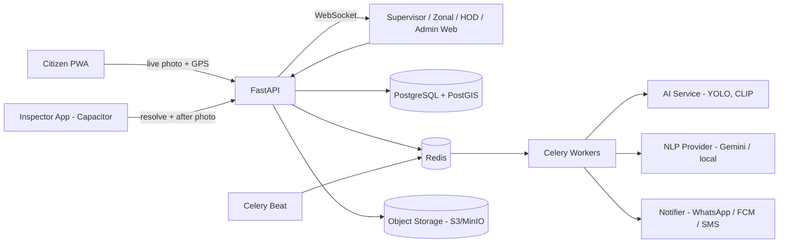
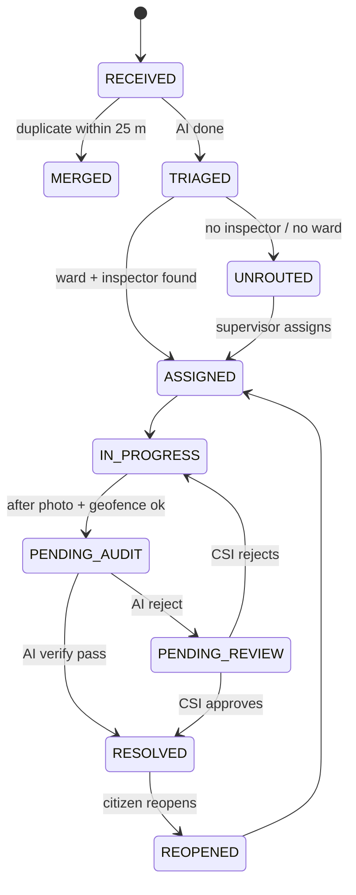

# CivicPulse AI — Architecture

Derived from the PRD plus corrections in `thinking/research.md` (decisions D1–D10).

## 1. System context



## 2. Components

| Component | Tech | Responsibility |
| --- | --- | --- |
| Citizen PWA | React, Vite, Tailwind, MapLibre | Live capture, nearby issues, Me Too, track, reopen |
| Inspector app | React + Capacitor (Android) | Task list, navigation, geofenced resolve, attestation |
| Command Center | React, MapLibre, Deck.gl, Recharts | Maps, leaderboards, SLA audit, review queue |
| API | FastAPI, SQLAlchemy 2, GeoAlchemy2, Pydantic v2 | AuthN/Z, CRUD, orchestration, WebSocket |
| Workers | Celery + Redis | Triage pipeline, notifications, escalations, KPI jobs |
| AI service | PyTorch, Ultralytics YOLO, CLIP | Detect, embed, verify (separate container, GPU optional) |
| NLP provider | Interface + Gemini / local zero-shot | Hazard keywords, urgency, landmark |
| DB | PostgreSQL 16 + PostGIS 3 | System of record, spatial queries |
| Object store | S3 / MinIO | Photos (private, signed URLs) |

## 3. Lifecycle as a state machine



Every transition writes an `issue_events` row (actor, from, to, reason, payload, timestamp). No update-in-place without an event.

## 4. Submit pipeline (sync vs async)

**Sync (<400 ms):** validate auth + capture nonce → check GPS accuracy → store image → insert `issue_reports` → enqueue `triage.run` → return `ticket_code` and status `RECEIVED`.

**Async `triage.run`:** 
1. Ward route (`ST_Covers`) → ward, zone.
2. Dedup (`ST_DWithin` 25 m, same category, open) → CLIP compare → merge or continue.
3. YOLO → class, confidence, bbox ratio.
4. NLP → hazard keywords, urgency, landmark.
5. Spatial proximity (hospital/school/arterial within 100 m).
6. Score + overrides → priority → `sla_deadline`.
7. Assign least-loaded on-duty inspector.
8. Notify inspector; push event to Admin WebSocket.

Dedup runs before the heavy models only after category is known; run a cheap YOLO class pass first, then dedup, then the rest.

## 5. Scoring

```
C_vision = 100 · conf · (0.6·class_weight + 0.4·min(bbox_ratio / 0.25, 1))
S = 0.35·C_vision + 0.25·U_nlp + 0.25·P_spatial + 0.15·min(upvotes·10, 100)
Overrides: Open_Manhole | live-wire/sparking | main-road blockage → CRITICAL
Priority: S ≥ 80 CRITICAL (4–6 h) · 60–79 HIGH (12–24 h) · <60 STANDARD (48–72 h)
```
Weights, class weights and SLA hours live in `sla_policies` / config table.

## 6. Resolution & verification

1. Inspector taps Resolve → app requests **capture nonce**.
2. Captures After photo in-app (no gallery) + GPS + `isMock` + attestation token.
3. API checks: ticket assigned to caller, accuracy ≤ 20 m, `ST_DWithin(issue.location, point, 30)`, nonce fresh, attestation valid, perceptual hash not seen before.
4. Status → `PENDING_AUDIT`; worker runs CLIP similarity (background match) + YOLO (target class absent).
5. Pass → `RESOLVED`, notify reporter for CSAT. Fail → `PENDING_REVIEW`.

## 7. Escalation engine

Celery Beat every 5 min, idempotent:

```sql
SELECT id, created_at, sla_deadline, escalation_level
FROM civic_issues
WHERE status IN ('ASSIGNED','IN_PROGRESS','TRIAGED','UNROUTED','REOPENED')
  AND sla_deadline < now() + interval '1 day';
```
Elapsed ratio = `(now - created_at) / (sla_deadline - created_at)`.
- ≥ 0.75 and no warning sent → yellow alert to Tier 1.
- ≥ 1.0 and level < 1 → `SLA_BREACHED_L1`, KPI −5 event, show on Tier 2 dashboard.
- ≥ 1.5 and level < 2 → L2: Tier 3 + ICCC red list.
- Repeat breaches (policy) → L3 recommendation to Dept Head (draft show-cause, human issues).
Use `SELECT … FOR UPDATE SKIP LOCKED` so overlapping beats never double-escalate.

## 8. Data model (corrected)

Core tables (full DDL in the PRD; changes below):

- `zones(id, zone_number, name, boundary MULTIPOLYGON)`; `wards(id, ward_number, name, zone_id, boundary MULTIPOLYGON)` with GIST.
- `users(id, full_name, phone, role ENUM, department ENUM, is_active, on_duty, last_seen)`.
- `user_ward_assignments(user_id, ward_id)` — replaces single `assigned_ward_id` for CSI/AE.
- `civic_issues(... location GEOGRAPHY(Point), master_issue_id, merged_count, severity_score, priority_level, sla_deadline, escalation_level, status, ai_audit_passed, fraud_flag)`.
- `issue_reports(id, issue_id, reporter_id, image_key, location, accuracy_m, note, captured_at, device_id)`.
- `issue_media(id, issue_id, kind BEFORE|AFTER, key, phash, clip_embedding VECTOR(512))` — use `pgvector`.
- `issue_upvotes(issue_id, user_id UNIQUE)`.
- `issue_events(id, issue_id, actor_id, type, from_status, to_status, payload JSONB, at)` — append-only.
- `sla_policies(priority, category, target_hours_min, target_hours_max, pause_rules JSONB)`.
- `escalations(id, issue_id, level, at, notified JSONB)`.
- `kpi_events(id, user_id, delta, reason, issue_id, at)`; `kpi_snapshots(user_id, month, sla_pct, csat, speed, reopen_pct, score)`.
- `notifications(id, user_id, channel, template, status, at)`.
- `devices(id, user_id, platform, attestation_status, last_seen)`.
- `chronic_spots(id, center GEOGRAPHY, radius_m, category, count_30d, first_seen, status)`.
- `ai_inference_log(id, issue_id, model, version, input_hash, output JSONB, latency_ms, at)`.
- `places(id, kind HOSPITAL|SCHOOL|ARTERIAL, name, geom)` for `P_spatial`.

Indexes: GIST on every geography/geometry; `(status, sla_deadline)`; `(assigned_to, status)`; `(ward_id, status)`; `(category, status)`.

## 9. Key queries

```sql
-- Ward routing
SELECT w.id, w.zone_id FROM wards w
WHERE ST_Covers(w.boundary, ST_SetSRID(ST_MakePoint(:lng,:lat),4326)) LIMIT 1;
-- fallback: nearest ward
SELECT id, zone_id FROM wards ORDER BY boundary <-> ST_SetSRID(ST_MakePoint(:lng,:lat),4326) LIMIT 1;

-- Dedup candidates
SELECT id FROM civic_issues
WHERE category = :cat AND status NOT IN ('RESOLVED','MERGED')
  AND ST_DWithin(location, ST_SetSRID(ST_MakePoint(:lng,:lat),4326)::geography, 25);

-- Geofence
SELECT ST_DWithin(location, ST_SetSRID(ST_MakePoint(:lng,:lat),4326)::geography, 30)
FROM civic_issues WHERE id = :id;

-- Least-loaded inspector
SELECT u.id FROM users u
JOIN user_ward_assignments a ON a.user_id = u.id
LEFT JOIN civic_issues i ON i.assigned_to = u.id AND i.status IN ('ASSIGNED','IN_PROGRESS')
WHERE a.ward_id = :ward AND u.role='FIELD_INSPECTOR' AND u.department=:dept
  AND u.is_active AND u.on_duty
GROUP BY u.id ORDER BY count(i.id) ASC LIMIT 1;
```

## 10. API surface (v1)

| Area | Endpoints |
| --- | --- |
| Auth | `POST /auth/otp/request`, `POST /auth/otp/verify`, `POST /auth/refresh` |
| Capture | `POST /capture/nonce`, `POST /issues` |
| Issues | `GET /issues/nearby`, `GET /issues/{id}`, `POST /issues/{id}/upvote`, `POST /issues/{id}/reopen` |
| Field | `GET /me/tasks`, `POST /issues/{id}/start`, `POST /issues/{id}/resolve` |
| Supervisor | `GET /wards/{id}/board`, `POST /issues/{id}/reassign`, `POST /reviews/{id}/decision` |
| Admin | `GET /analytics/heatmap`, `/analytics/leaderboard`, `/analytics/sla`, `/analytics/blackspots` |
| Realtime | `WS /ws/admin`, `WS /ws/ward/{id}` |
| Ops | `GET /healthz`, `GET /metrics` |

All list endpoints are paginated; all mutating endpoints are idempotent via `Idempotency-Key`.

## 11. Deployment

- Docker Compose for dev; Kubernetes (or Docker Swarm/VM) for prod.
- Services: `api`, `worker-triage`, `worker-notify`, `beat`, `ai-service`, `postgres`, `redis`, `minio`, `nginx`.
- Separate Celery queues: `triage`, `verify`, `notify`, `escalate`, `analytics` with their own concurrency.
- CI: lint → tests → migration check → build images → deploy to staging → smoke tests.
- Environments: dev, staging, prod; secrets via env/secret manager.

## 12. Non-functional requirements

| Area | Target |
| --- | --- |
| Submit latency | p95 < 400 ms |
| Triage latency | p95 < 30 s end-to-end |
| Availability | 99.5% (pilot), 99.9% (prod) |
| Escalation | Zero missed; max drift 5 min |
| Map | 10k+ points at 60 FPS (Deck.gl) |
| Audit | 100% state changes in `issue_events` |
| Backups | Daily full + WAL, tested restore |

## 13. Observability

Structured JSON logs with `ticket_code`, Prometheus metrics (queue depth, inference latency, escalation lag), Grafana dashboards, Sentry for errors, alerting on beat heartbeat and queue backlog.
+-----------------------------------------------------------------------------------+
|                        CLIENT LAYER (React 18 + Vite + PWA)                       |
|                                                                                   |
|  +-----------------------+  +-------------------------+  +---------------------+  |
|  | Citizen Reporting App |  | Field Inspector PWA     |  | Super Admin ICCC    |  |
|  | - WebRTC Live Camera  |  | - 30m Geofence Lock     |  | - Deck.gl H3 Map    |  |
|  | - GPS Accuracy Gate   |  | - IndexedDB Offline Q   |  | - 85-Ward Choropleth|  |
|  | - Upvote Nearby       |  | - Before/After Capture  |  | - KPI Leaderboard   |  |
|  +-----------+-----------+  +------------+------------+  +----------+----------+  |
+--------------|---------------------------|--------------------------|-------------+
               | HTTPS / REST              | HTTPS / Background Sync  | WSS (Live)
               v                           v                          v
+-----------------------------------------------------------------------------------+
|                     API GATEWAY & CORE SERVICE (FastAPI Async)                    |
|                                                                                   |
|  +-----------------------+  +-------------------------+  +---------------------+  |
|  | 6-Tier RBAC & Auth    |  | Spatial Routing Service |  | ICCC WebSocket Hub  |  |
|  | - JWT Scope Guard     |  | - ST_Contains (Ward/Zn) |  | - Redis Pub/Sub     |  |
|  | - Velocity Anti-Spoof |  | - ST_DWithin (25m Dedup)|  | - Real-Time Ticker  |  |
|  +-----------+-----------+  +------------+------------+  +----------+----------+  |
+--------------|---------------------------|--------------------------|-------------+
               |                           |                          |
      +--------+--------+                  | Async SQLAlchemy 2.0     |
      | Redis 7 Broker  |                  v                          |
      | & Pub/Sub Bus   |     +------------------------------------+  |
      +--------+--------+     | PostgreSQL 16 + PostGIS 3.4        |  |
               |              | - zones (22 Polygons, GiST Index)  |  |
               v              | - wards (85 Polygons, GiST Index)  |  |
+-----------------------+     | - civic_issues (Point, GiST Index) |  |
| CELERY ASYNC WORKERS  |     | - users, audit_logs, upvoters      |  |
| & CELERY BEAT (5m)    |     +------------------------------------+  |
|                       |                  ^                          |
| - YOLOv8 CV Worker    |------------------+                          |
| - CLIP Visual Auditor |---------------------------------------------+
| - Hinglish NLP Parser |     +------------------------------------+
| - SLA Watchdog Cron   |---->| Object Storage (AWS S3 / MinIO)    |
+-----------------------+     | - Signed Before/After WebP Blobs   |
                              +------------------------------------+